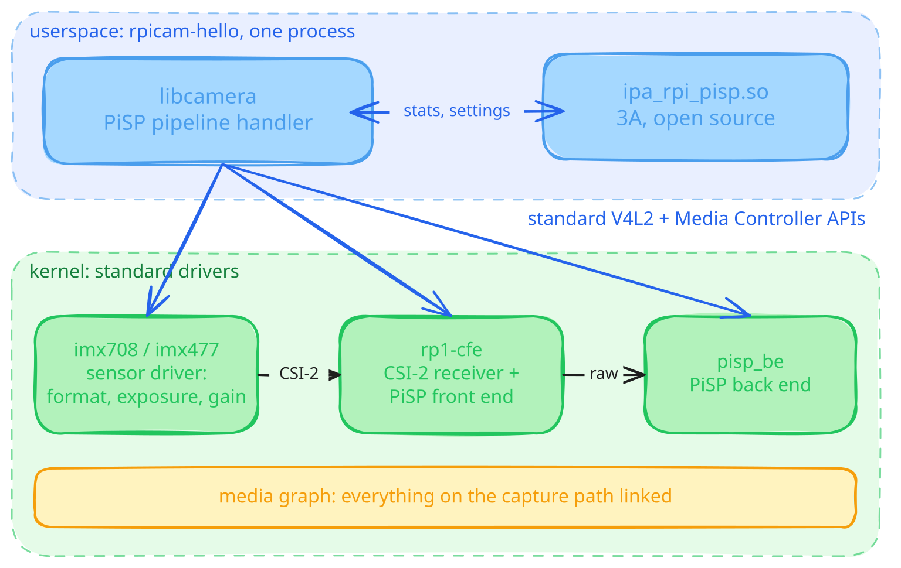
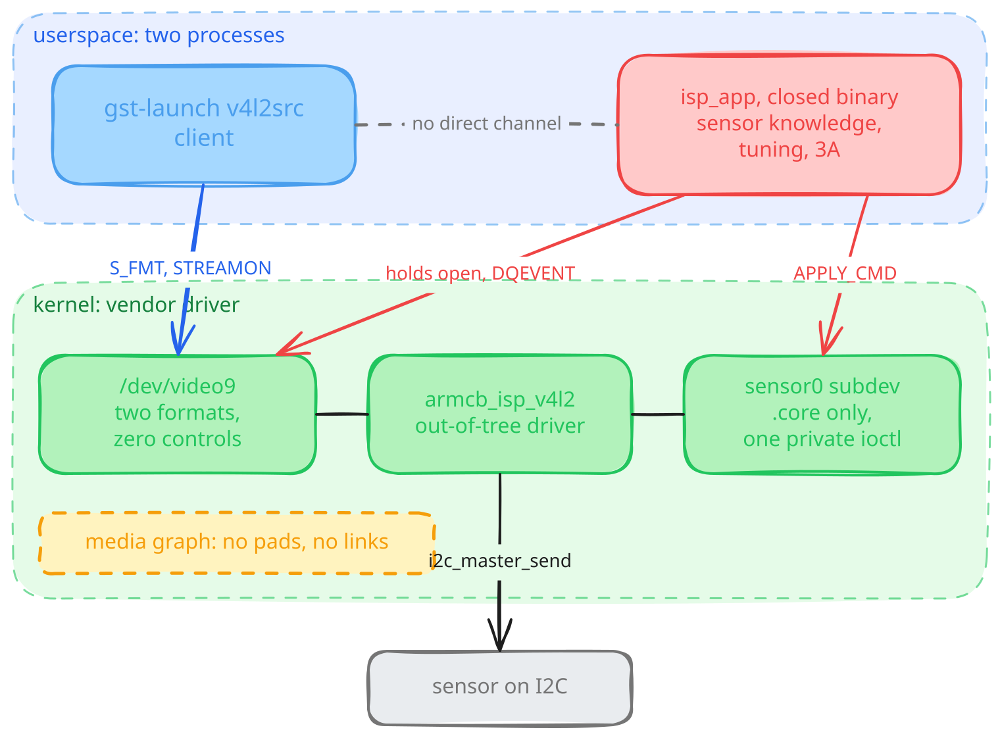
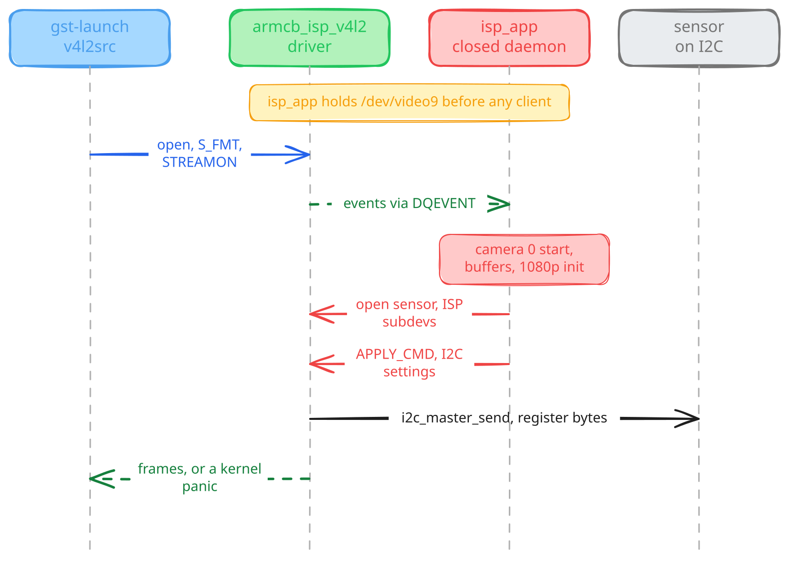
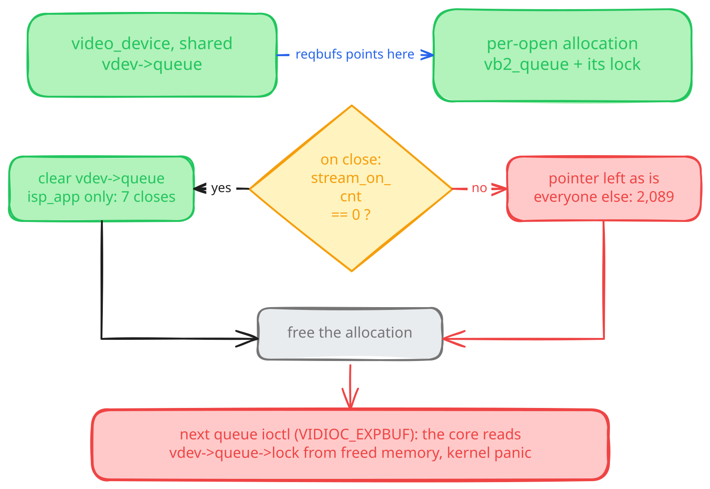

---
date:
  created: 2026-11-23
tags:
  - isp
  - v4l2
  - libcamera
  - mipi-csi2
  - raspberry-pi
  - orange-pi
---

# MIPI Cameras on Raspberry Pi 5 and Orange Pi 6 Plus: Two ISP Architectures

I have a Raspberry Pi 5 and an Orange Pi 6 Plus side by side, each with a MIPI camera. Both expose `/dev/video*` nodes and speak V4L2, so on paper both should be boring to capture from.

The Pi was boring: ten `rpicam-hello` runs, ten captures. On the Orange Pi, ten `gst-launch-1.0 v4l2src device=/dev/video9` runs gave me three captures, a mix of hangs, `Failed to allocate required memory` and `has no supported format`, and one reboot mid-run. A day later I interleaved every MIPI capture with one from a Logitech C920 on the same board's USB port. MIPI got six out of ten, and all four failures were the board resetting. The C920 got ten out of ten.

So neither the board nor V4L2 is broken. What differs is the architecture of the camera stack: where the sensor knowledge lives, what the kernel tells userspace, and who owns the capture device.

??? info "Why bother with the Orange Pi at all: the hardware gap"

    On paper the boards aren't in the same league. The CIX P1 has an NPU rated at about 30 TOPS (the 45 TOPS on the box counts the CPU and GPU too) and a hardware H.264/H.265 encoder rated up to 8K at 30 fps[^cix-specs]. The Pi 5 has neither: no NPU and, unlike the Pi 4, no hardware H.264 encoder, so encoding means libx264 on the CPU[^rpi-h264].

    The AI HAT+ 2 (Hailo-10H, 40 TOPS INT4, 8 GB of its own RAM[^ai-hat-2]) fills the NPU gap; the original AI HAT+ never interested me. A kit costs about $350 today, and I paid $366 for the whole Orange Pi. Price isn't the real problem, though. The HAT only accelerates inference. Every streamed frame still goes through libx264 on the CPU, and there's no DMA path from camera to accelerator to encoder for the HAT to sit in, so for my experiments there's not much reason to add one.

    The Pi wins a lot back on power: it gets by with a small fan, while the Orange Pi needs a blower that wouldn't look out of place in a gaming laptop. On a battery or in a sealed enclosure, that matters more than TOPS.

## What a MIPI camera stack has to do

The sensor sits on an I²C bus, and everything about it (mode, exposure, gain) is a register write. Raw Bayer pixels come out over CSI-2 into a receiver on the SoC, and the ISP turns them into something usable like NV12 while producing per-frame statistics. 3A (auto exposure, white balance, focus) reads those statistics and writes new settings back to the sensor and the ISP, every frame.

??? info "What I²C is"

    I²C, written I2C in code, is Inter-Integrated Circuit: a slow two-wire bus (clock plus data) Philips designed in the early 1980s. Devices have 7-bit addresses, so `11-001a` on the Pi below means bus 11, address `0x1a`. At 100 or 400 kHz it can't carry pixels, which is why a camera has two paths: I²C for control (mode, exposure, gain, chip ID) and CSI-2 for frames. Linux sensor drivers live in `drivers/media/i2c/`, and `i2c_master_send()`, which puts bytes on the bus, shows up again later.

Both boards run 3A in userspace. What differs is the interface between userspace and the kernel, and how much of the hardware the kernel describes.

## Raspberry Pi 5: the kernel describes the hardware

Start with the sensors:

```text
$ for s in /sys/class/video4linux/v4l-subdev*; do echo "$(basename $s) $(cat $s/name)"; done
v4l-subdev0 csi2
v4l-subdev1 pisp-fe
v4l-subdev2 imx477 11-001a
v4l-subdev3 csi2
v4l-subdev4 pisp-fe
v4l-subdev5 imx708
v4l-subdev6 dw9807 10-000c
```

Each sensor model has its own driver at a real I²C address, and that driver owns the mode tables, format negotiation, exposure and gain behind standard subdev operations and controls.

Every block is also an entity in a Media Controller graph. Of the Pi's 44 entities only one sits outside it, the `dw9807` focus motor; everything on the capture path is linked. Each camera port is an `rp1-cfe` graph (sensor, CSI-2 receiver, the PiSP front end that produces statistics, video nodes), and the PiSP back end, a memory-to-memory ISP, has a graph of its own. A client finds a camera's nodes by following links from the sensor instead of guessing `/dev/videoN`, and the capture node sets `V4L2_CAP_IO_MC`, the flag that says the topology is configured through the Media Controller[^io-mc].

libcamera's PiSP pipeline handler does that walking, configures formats pad by pad, sets sensor controls and runs the capture loop. The 3A algorithms come in an IPA module, `ipa_rpi_pisp.so`, which in my setup is loaded straight into the application's process.

{ width="1024" }

One process owns the session. At idle `fuser` finds nothing holding any camera node. During a capture `rpicam-hello` holds every node it needs, with libcamera and the IPA in its own address space, and when it exits they're all free again.

The stack isn't fully upstream: `rp1-cfe` and `pisp_be` are in mainline, but the `imx708` and `imx477` drivers live in Raspberry Pi's own tree[^rpi-imx708]. Every boundary in it is still a mainline interface, and the IPA ships under open licences. libcamera doesn't even require that: an IPA whose `.sign` signature doesn't validate runs in a separate, isolated process[^ipa-iso], so a vendor's closed 3A fits the design.

That's why the Pi holds up: nothing important is private. The kernel describes the sensor, the links, the formats and the controls, so userspace can be libcamera, my own V4L2 code or anything else that speaks the same API.

## Orange Pi 6 Plus: a daemon and a register pipe

The same idle check on the Orange Pi gives a different answer. Before any capture, `fuser` already finds the camera node open:

```text
$ sudo fuser -v /dev/video*
                     USER        PID ACCESS COMMAND
/dev/video9:         root       4374 F.... isp_app
```

`isp_app` is the vendor's camera daemon, a closed-source binary. systemd starts it through a unit called `isp-daemon.service`, and from then on `isp_app` holds `/dev/video9` for as long as it runs. No installed package owns the binary or the unit. In the vendor's repository it belongs to `cix-isp-umd` (UMD is "user mode driver"), and CIX ships the GPU and NPU the same way: a GPL kernel module plus a closed userspace half.

The kernel half is `armcb_isp_v4l2`, an out-of-tree module in `/lib/modules/<version>/extra/`. The GPL source is published[^cix-src], but the loaded module has no `srcversion` to tie it to that source, so the driver internals below come from the published tree.

{ width="1024" }

### Where the sensor knowledge went

The sensors are ACPI devices, and all three camera I²C devices bind to one generic driver, `imgsensor0`, with identical subdev names:

```text
v4l-subdev0 name=sensor0
v4l-subdev1 name=sensor0
v4l-subdev2 name=sensor0
```

The published driver tree contains no sensor model names at all, so the kernel side doesn't know which sensor is attached. `isp_app` does: its strings name four OmniVision sensors (`ov08d10`, `ov13850`, `ov13855`, `ov13858`), and the proprietary package ships tuning files for them. Two of the four have mainline drivers. The vendor stack uses neither.

### No graph to walk

The driver creates media devices, but look inside one (trimmed):

```text
$ media-ctl -d /dev/media2 -p | grep -E "^- entity|device node name"
- entity 1: armcb-00-vid-cap (0 pad, 0 link)
            device node name /dev/video9
- entity 4: sensor0 (0 pad, 0 link)
            device node name /dev/v4l-subdev2
- entity 5: isp-sub1 (0 pad, 0 link)
            device node name /dev/v4l-subdev3
- entity 6: motor0 (0 pad, 0 link)
            device node name /dev/v4l-subdev4
...
```

All 13 entities across the three ISP media devices have zero pads and zero links, because the driver never creates any (`media_create_pad_link` appears nowhere in the source), and `/dev/video9` doesn't set `V4L2_CAP_IO_MC`. There's no graph to walk. The Pi leaves its focus motor outside the graph too, but there it's the only one. Here it's all thirteen.

The subdevs are just as empty. Every `v4l2_subdev_ops` in the driver fills only `.core`, and the sensor's core ops hold one ioctl handler:

[`sensor/armcb_sensor.c`](https://github.com/orangepi-xunlong/component_cix-current/blob/cbcd1803a930bb7d4da525ed740cdf3233c05678/cix_opensource/isp/isp_driver/sensor/armcb_sensor.c)

```c
	switch (cmd) {
	case ARMCB_VIDIOC_APPLY_CMD: {
		struct cmd_buf *pcmd_buf = (struct cmd_buf *)arg;

		switch (pcmd_buf->static_info.bus) {
		case HW_BUS_AHB_POWER:
			res |= armcb_imgsens_hw_apply(pcmd_buf, pimgsens_sd);
			break;
		default:
			res |= armcb_isp_hw_apply(pcmd_buf, client);
			break;
		}
		break;
	}
	default:
		return -ENOIOCTLCMD;
	}

/* ... */

static struct v4l2_subdev_ops armcb_imgsens_subdev_ops = {
	.core = &armcb_imgsens_subdev_core_ops,
};
```

No `.pad`, no `.video`, so mainline's `v4l2_subdev_call()` returns `-ENOIOCTLCMD` for `set_fmt`, `enum_mbus_code` or `s_stream` before any driver code runs[^subdev-call]. A libcamera pipeline handler would have nothing to call.

### One private ioctl

That one command is how the sensor gets configured. `ARMCB_VIDIOC_APPLY_CMD` is `BASE_VIDIOC_PRIVATE + 2`, and `BASE_VIDIOC_PRIVATE` is 192[^private], so it's ioctl number 194. The same header also defines `ARMCB_VIDIOC_ISP_DMA_COPY` as 194 and gives `VIDIOC_ARMCB_ISP_STAT_EN` number 194 as well, so the number doesn't even identify the command :-D The payload carries bus-specific settings. The I²C one:

[`common/armcb_isp.h`](https://github.com/orangepi-xunlong/component_cix-current/blob/cbcd1803a930bb7d4da525ed740cdf3233c05678/cix_opensource/isp/isp_driver/common/armcb_isp.h)

```c
struct cmd_i2c_setting {
	unsigned int channel;
	unsigned int slave_addr;
	enum drv_direction direct;
	enum drv_addr_type reg_addr_type;
	enum drv_data_type reg_data_type;
	unsigned int reg_addr;
	unsigned int *ptr_user;
	unsigned int val;
	unsigned int delay_us;
};
```

Slave address, register address, widths and value all come from userspace. The kernel marshals them into bytes and calls `i2c_master_send()`; a comment in the ordering code says `/// already sort in userspace`. The driver is a privileged register pipe plus a buffer manager, and the hardware description, register tables, tuning and 3A all live in `isp_app`.

The capture node shows the same split. `/dev/video9` exposes zero V4L2 controls, while the C920 on the same board exposes 23. AE, AWB and AF modes exist only in `isp_app`'s own command language, documented in its `-h` output.

### How a capture actually starts

Client and daemon never talk directly. `isp_app` has no socket or FIFO, just `/dev/video9`, `/dev/null` and its journal, so the driver's event queue is their only channel. The daemon's log when a `gst-launch` client starts, trimmed:

```text
daemon.c Daemon_Subevent_Process(137): VIDIOC_DQEVENT success ret(0)
Daemon_Event_Process enter --->, event_id:108
daemon.c Daemon_Subevent_Process(137): VIDIOC_DQEVENT success ret(0)
Daemon_Event_Process enter --->, event_id:106
app_layer.c App_Layer_Camera_Start(892): camera 0 starting
device_buf_mgr.c Device_Buf_Allocate(379): allocate 5(5) buffers success
app_layer.c App_Layer_Camera_Start(945): camera 0 started
pipeline.c Pipeline_Initialize(1302): cam 0: ... preview[1920*1080] ...
isp_hw_v4l.c Isp_V4l_Open_Subdev(532): open file /dev/v4l-subdev2
isp_hw_v4l.c Isp_V4l_Open_Subdev(532): open file /dev/v4l-subdev3
```

The client's open, `S_FMT` and `STREAMON` become events. The daemon wakes on `VIDIOC_DQEVENT`, starts camera 0, allocates buffers, initialises its 1080p pipeline and opens the sensor and ISP subdevs. From there, `ARMCB_VIDIOC_APPLY_CMD` is the only sensor-register path the driver offers. I didn't trace the daemon's syscalls, so that last hop comes from the driver source rather than observation.

{ width="1024" }

## Why the Orange Pi stack breaks

### The kernel panic

The vendor image keeps logs in RAM (`orangepi-ramlog`) and `ramoops` caught nothing, so at first the resets left no trace. With a persistent journal I have five panics. Every one faults in the same place, `__video_do_ioctl` taking a mutex, and three of them look like this:

```text
armcb_v4l2_core.c armcb_g_param (1399): g_param enter
armcb_v4l2_core.c armcb_v4l2_g_selection (1340): enter: target = 257, type = 1
Unable to handle kernel paging request at virtual address 004e495f43455355
Internal error: Oops: 0000000096000004 [#1] PREEMPT SMP
CPU: 10 PID: 5318 Comm: v4l2src0:src Tainted: G S         O
pc : mutex_lock_interruptible+0x10/0x6c
lr : __video_do_ioctl+0xe0/0x3c8
...
Call trace:
 mutex_lock_interruptible+0x10/0x6c
 video_usercopy+0x200/0x760
 video_ioctl2+0x18/0x30
 v4l2_ioctl+0x40/0x60
Kernel panic - not syncing: Oops: Fatal exception
```

The other two faulted deeper inside the same lock acquisition, one in `osq_lock` and one in `queued_spin_lock_slowpath`, under the same `__video_do_ioctl` call. A mutex whose internal fields are unreadable too isn't a mutex with a bad address. It's memory that stopped being a mutex.

The crash is in the mainline V4L2 core, in GStreamer's capture thread `v4l2src0:src`, and the core takes that lock before it ever calls the driver[^ioctl-core]. The mutex address is in `x1`, the register the fast-path compare-and-swap writes through, and in this trace it's `0x494e495f43455355`: text, `USEC_INI` in little-endian ASCII. (The reported fault address loses the top byte because the kernel sign-extends bit 55 before printing it.)

The driver source says why[^cix-queue]. `vdev->queue` is one field on the shared `video_device`, and `armcb_v4l2_reqbufs` points it at a `vb2_queue` embedded in a per-open allocation. On close, `armcb_v4l2_fop_release` clears that pointer only when `stream_on_cnt` is zero, then frees the allocation either way. Of 2,096 releases in my logs, `stream_on_cnt` was zero on seven, all of them `isp_app` closing `/dev/video9`. Every other close leaves the device pointing into freed memory, and the core reads `vdev->queue->lock` for any queue ioctl.

{ width="1024" }

The register dump even names the ioctl that walked into it. `x20` holds `0xc0405610`, which is `VIDIOC_EXPBUF`, a queue ioctl GStreamer issues while probing whether the node can export dmabufs. The `g_selection` call logged just before it survived because it isn't a queue ioctl and takes the device mutex instead. So this is a use-after-free on the capture node's queue pointer, caused by a cleanup that the driver's own stream counter skips almost every time. The vendor's `/* need fix: hard code for NV12M 1080p fmt */` comment sits inside `armcb_v4l2_g_selection`, the function that logs the last line before every panic.

Stopping the daemon doesn't help either. With `isp-daemon.service` stopped and no `isp_app` running, one capture hung and the next panicked two seconds later, with the same trace. The bug is in the kernel driver, and without the daemon there's no fallback path, just nothing.

### Why the architecture makes it worse

A buggy driver can happen to anyone. The shape of this stack makes it worse.

The driver is the only meeting point for parties that don't know about each other: the client, the daemon that holds the node permanently, and every other program that opens video devices. The vendor image runs a full desktop, so there are plenty of those: `wireplumber`, `v4l_id`, `gst-plugin-scan`, `gst-launch-1.0`, `v4l2-ctl` and `isp_app` itself, anywhere from 15 to over a thousand closes per boot. Only the daemon's own closes are counted. Everyone else's prints `stream_on_cnt:-1`, and that's exactly the gap the panic falls through. On the Pi, one process owns the session and the V4L2 core tracks it. Here the driver keeps its own per-stream state for a client it doesn't configure and a daemon it reaches only through events.

Nothing is standard either. No graph, no pad operations, no controls: libcamera can't drive it, my own code can't set exposure, and when something breaks no standard tool can show the state, because it lives in a closed binary and a private struct.

Then supportability. Neither `isp_app` nor its unit belongs to a package, so nothing updates or removes them, and `isp-daemon.service` is sloppy:

```ini
[Unit]
Description=ISP Daemon
After=network.target load-isp-modules.service

[Service]
Type=simple
Environment=LD_LIBRARY_PATH="/usr/share/cix/lib"
ExecStart=/usr/bin/isp_app -s 0 &
Restart=always
RestartSec=1
StartLimitInterval=10
StartLimitBurst=5

[Install]
WantedBy=multi-user.target
```

systemd doesn't use a shell, so that `&` reaches the binary as a literal argument, and `load-isp-modules.service` doesn't exist on the image. Worse, the daemon's stdout goes to journald rather than a tty, so glibc fully buffers it. On one boot journald stamped a line at 14:10 that the daemon itself had timestamped 03:32, ten and a half hours earlier, and delays of several minutes are routine. Lining a crash up with daemon activity is hard when the logs arrive that late.

## The line that actually matters

It's tempting to read this as "closed daemon bad, open library good". That's the wrong line: libcamera itself runs closed IPAs in a separate process. Neither the process boundary nor closed 3A is the problem.

The line is what the kernel describes. On the Pi 5 it describes the sensor, the links, the formats and the controls through mainline interfaces, so userspace is replaceable and a session lives as long as one process. On the Orange Pi 6 Plus the kernel is a privileged I²C pipe and a buffer manager, the hardware description lives in a closed binary, and the contract between them is a private ioctl whose number collides with another one. The rest follows: no libcamera, no controls, state spread across processes that never talk, and a driver that panics the kernel with or without the daemon.

Nothing here says the CIX ISP silicon is bad. It says the software contract around it was written for exactly one closed client. Until CIX ships a driver that builds a graph, the reliable camera interface on my Orange Pi is its USB port.

## Related

- [The Linux Camera Stack](../video/linux-camera-stack.md) — the V4L2 and Media Controller interfaces this article measures two stacks against, in detail: node kinds, capability bits, pad writes and where `STREAMON` refuses.
- [Camera Sensor Fundamentals](../video/camera-sensor-fundamentals.md) — the sensor side: Bayer colour filter arrays, bit depth and why raw frames need an ISP at all.
- [Accelerators](index.md) — the other three pieces of vendor silicon on the same board, including the encoder that scales to eighteen 1080p streams while its decoder manages one.

[^cix-specs]: [Orange Pi 6 Plus: CIX P1 SBC offers up to 64GB LPDDR5 memory, 45 TOPS of AI performance. CNX Software, October 15, 2025.](https://www.cnx-software.com/2025/10/15/orange-pi-6-plus-cix-p1-sbc-64gb-lpddr5-45-tops-ai-performance/)

[^rpi-h264]: [H.264 encoding performance on Raspberry Pi 5-series computers. Raspberry Pi Ltd white paper, April 2026.](https://pip-assets.raspberrypi.com/categories/685-app-notes-guides-whitepapers/documents/RP-010033-WP-1-H.264%20encoding%20performance%20on%20Raspberry%20Pi%205_series%20computers.pdf)

[^ai-hat-2]: [Raspberry Pi AI HAT+ 2 product page. Raspberry Pi Ltd.](https://www.raspberrypi.com/products/ai-hat-plus-2/)

[^io-mc]: [`V4L2_CAP_IO_MC` in `vidioc-querycap.rst`. Linux kernel documentation, mainline at 7475ea8.](https://github.com/torvalds/linux/blob/7475ea8b58616b33c04afb976cf0fbaad9dd63fb/Documentation/userspace-api/media/v4l/vidioc-querycap.rst)

[^rpi-imx708]: [`drivers/media/i2c/imx708.c` in the Raspberry Pi kernel tree.](https://github.com/raspberrypi/linux/blob/ab4372076bb840600e522ae776887ae2bc488fa6/drivers/media/i2c/imx708.c)

[^ipa-iso]: [`IPAManager::isSignatureValid()` in `src/libcamera/ipa_manager.cpp`, libcamera 0.5.2.](https://sources.debian.org/src/libcamera/0.5.2-3~bpo13%2B1/src/libcamera/ipa_manager.cpp/) A module whose signature does not verify fails this check, and the manager spawns an IPAProxy worker process instead of loading it: "Open-source modules are loaded without isolation, while closed-source module are forcefully isolated." Isolation can also be forced for every module with [`LIBCAMERA_IPA_FORCE_ISOLATION`](https://sources.debian.org/src/libcamera/0.5.2-3%7Ebpo13%2B1/Documentation/environment_variables.rst/). See also [the patch that added it](https://lists.libcamera.org/pipermail/libcamera-devel/2021-July/022220.html), which notes that deleting a module's signature file already forces isolation.

[^cix-src]: [`cix_opensource/isp` in `orangepi-xunlong/component_cix-current` at cbcd180.](https://github.com/orangepi-xunlong/component_cix-current/tree/cbcd1803a930bb7d4da525ed740cdf3233c05678/cix_opensource/isp)

[^cix-queue]: `vdev->queue = &sp->vb2_q` in [`armcb_v4l2_reqbufs()`](https://github.com/orangepi-xunlong/component_cix-current/blob/cbcd1803a930bb7d4da525ed740cdf3233c05678/cix_opensource/isp/isp_driver/isp/armcb_v4l2_core.c#L847), the conditional clear in [`armcb_v4l2_fop_release()`](https://github.com/orangepi-xunlong/component_cix-current/blob/cbcd1803a930bb7d4da525ed740cdf3233c05678/cix_opensource/isp/isp_driver/isp/armcb_v4l2_core.c#L429), and the per-open `vb2_queue` in [`struct armcb_isp_v4l2_fh`](https://github.com/orangepi-xunlong/component_cix-current/blob/cbcd1803a930bb7d4da525ed740cdf3233c05678/cix_opensource/isp/isp_driver/isp/armcb_v4l2_core.h#L141), all at cbcd180.

[^subdev-call]: [`v4l2_subdev_call()` in `include/media/v4l2-subdev.h`, mainline at 7475ea8.](https://github.com/torvalds/linux/blob/7475ea8b58616b33c04afb976cf0fbaad9dd63fb/include/media/v4l2-subdev.h)

[^private]: [`BASE_VIDIOC_PRIVATE` in `include/uapi/linux/videodev2.h`, mainline at 7475ea8.](https://github.com/torvalds/linux/blob/7475ea8b58616b33c04afb976cf0fbaad9dd63fb/include/uapi/linux/videodev2.h)

[^ioctl-core]: [`__video_do_ioctl()` and `v4l2_ioctl_get_lock()` in `drivers/media/v4l2-core/v4l2-ioctl.c`, mainline at 7475ea8.](https://github.com/torvalds/linux/blob/7475ea8b58616b33c04afb976cf0fbaad9dd63fb/drivers/media/v4l2-core/v4l2-ioctl.c)
